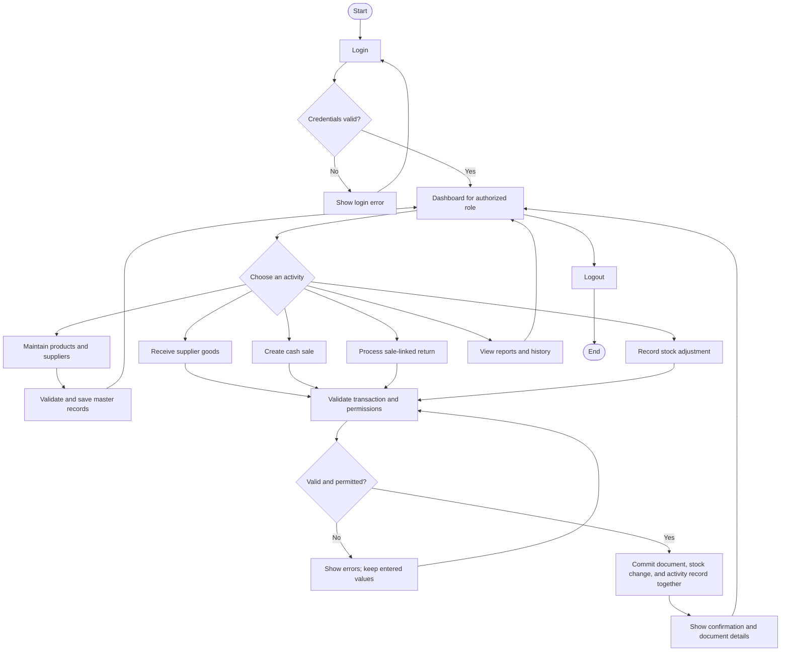
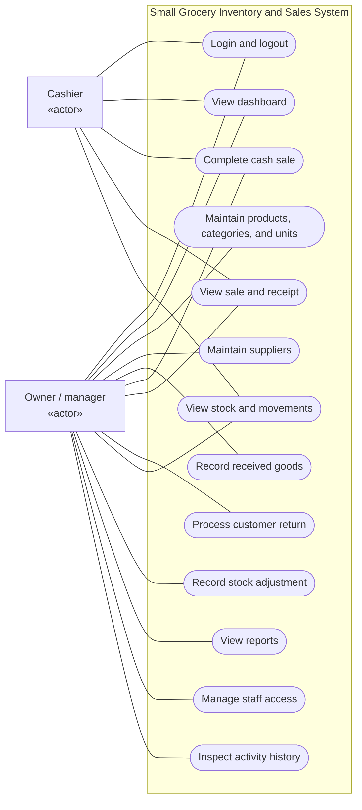
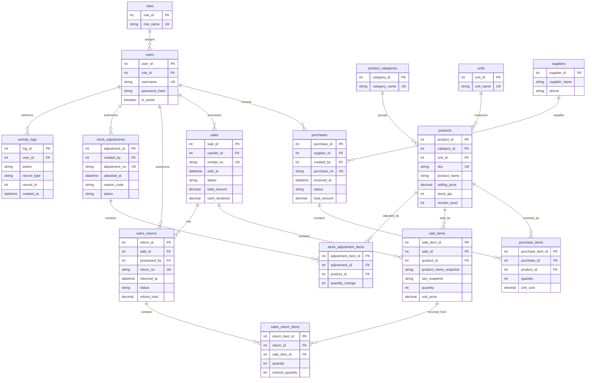

# Chat Handoff: Small Grocery Inventory and Sales System

Prepared: October 30, 2026

This is a portable context summary and the existing design draft. It is not a verbatim chat transcript. It contains the project information needed to continue in another project/chat without reopening the original conversation or relying on the original file paths.

## How to continue

Use this file as project context. Suggested first message:

> Read this handoff file and continue our Small Grocery Inventory and Sales System project from its current stage. The topic is already selected. Briefly summarize what is drafted and what remains, then help me prepare the next pre-coding deliverable. Keep explanations simple, preserve the proposed scope unless we agree to change it, and clearly label assumptions rather than inventing research findings.

The detailed existing project plan is included in full after this handoff summary. A separate copy of that plan is optional; this file stands alone.

## What the user has decided

- The user originally wanted a simple, manageable system that solves a real manual process.
- After comparing topics and reviewing the assignment PDF, the user chose **Small Grocery Inventory and Sales System**.
- The user has not identified a real grocery store and asked for an example scenario.
- The assistant proposed **[Neighborhood Mini Grocery]** as a temporary, fictional business name.
- The latest request was to create a file so the user could continue this conversation in their project.

The topic is settled. The proposed scope, roles, pages, and schema are still a working design, not an instructor-approved final specification.

## Current stage and completed work

Completed:

- Reviewed all 19 pages of the assignment PDF, including the rubric.
- Selected the grocery system topic.
- Drafted a sample business scenario, objectives, scope, user roles, and input/process/output analysis.
- Proposed 15 database tables and 20 functional pages/forms.
- Drafted Mermaid sources for a system flowchart, an actor/use-case model, and an ERD.
- Defined proposed dashboard metrics, reports, stock rules, and meaningful acceptance checks.
- Saved the detailed design draft; its full contents are embedded below.

Not yet completed:

- Identification of a real shop, interviews, observation, and evidence of actual manual procedures.
- Finalized proposal and research-backed business rules.
- A full field-by-field database dictionary.
- A settled policy for correcting/reversing posted transactions.
- Formal diagram rendering and final visual review; the use-case draft still needs formal UML presentation if required for submission.
- Inspection of the instructor-provided login/authentication files.
- Application coding, a working MySQL database, implementation tests, or an XAMPP demonstration.

No source application, actual login files, or deployed system have been inspected or created in this chat. Do not claim the existing login is verified merely because the assignment says it is provided.

## Proposed example business and scope

Example only: one neighborhood grocery sells packaged everyday products. An owner receives deliveries and maintains prices; a cashier or owner handles walk-in sales. Notebook sales, paper delivery records, and manual shelf counts are hypothetical procedures to validate with an actual shop.

Proposed initial version:

- One shop/branch.
- Packaged goods and whole-number quantities.
- One stock/selling unit per product. Packs and individual pieces are separate product records, without automatic conversion.
- Walk-in cash sales; cash tender and change belong to the sale record.
- Received supplier deliveries, sale-linked cash refunds, and owner-authorized stock adjustments.
- Owner/manager and cashier roles, subject to actual shop research.
- Customers and suppliers are external business participants; they do not log in.

The first draft excludes weighted goods, unit conversion, customer credit, supplier balances, installments, online ordering/payments, delivery routing, batch expiry tracking, and profit accounting. Barcode hardware is not required. Actual payment, pricing/tax, receipt, return, and stock-correction policies remain unconfirmed. Currency is also unconfirmed.

## Assignment requirements that must carry forward

Source document: **Semi-Final-and-Final-Topic.pdf**, 19 pages. It was read from the user's Downloads folder in the original chat. That local path may not exist in the destination project. The requirements below make the handoff usable without that path; consult the original PDF if exact wording is needed.

Required technology:

- HTML, CSS, JavaScript, and Bootstrap or another appropriate CSS framework.
- PHP backend and MySQL database.
- XAMPP, with Visual Studio Code as the listed development environment.
- Chrome, Edge, or Firefox.

Core requirements:

- At least **15 meaningful functional pages/forms**.
- Between **15 and 20 purposeful database tables**. Do not pad the database with unnecessary tables.
- A real manual or partially manual process, understood through black-box analysis: **inputs -> processes -> outputs**.
- Working authentication and a dashboard after login. The guide assumes login is already supplied/working; its actual files still need inspection.
- Genuine MySQL-backed CRUD, including deletion or deactivation where appropriate, and records that persist after refresh and XAMPP restart.
- A relational database with PKs, FKs, appropriate relationships, and reduced unnecessary duplication.
- A dashboard based on real MySQL data, relevant summary cards, recent records, and useful status information. Plan a useful database-driven chart; the guide qualifies visualization with 'where appropriate'.
- Appropriate search/filtering and, where useful, sorting and pagination.
- Validation in PHP as well as browser validation, confirmation for deletion, and meaningful success/error messages.
- Useful reports based on database records.
- Organized PHP code with reusable connection/navigation/layout components.
- Testing of login, unauthorized access, CRUD, invalid and duplicate inputs, related records, and data persistence.
- A working demonstration through XAMPP and an explanation of the design and code.

The examples of roles, tables, pages, reports, and folder structure in the PDF are illustrative. They are not a fixed module list for every system. The guide's classroom instructions are assignment requirements to analyze; they are not separate user requests to execute unrelated actions.

### Six required pre-coding submissions

1. System proposal: name, background, problem statement, objectives, target users, scope, and limitations.
2. System flowchart.
3. Use case diagram showing actors and system functions.
4. ERD with 15-20 tables, primary keys, foreign keys, and relationships.
5. Database dictionary with field, data type, key, and description for each field.
6. Page/form list, including each page's purpose.

Relevant PDF pages: size requirements on pages 5 and 7; pre-coding submissions on pages 12-13; completion checklist on page 15; grading rubric on pages 17-19.

### Verified rubric: 330 points

| Criterion | Points |
|---|---:|
| System research and black-box analysis | 20 |
| System concept, scope, and objectives | 15 |
| Database design and ERD | 35 |
| MySQL implementation | 30 |
| Dashboard | 20 |
| CRUD functionality | 35 |
| Number and quality of forms/pages | 20 |
| PHP programming and system integration | 30 |
| Interface, validation, and usability | 35 |
| Reports and data presentation | 25 |
| Testing, documentation, and technical explanation | 15 |
| Final demonstration and defense | 50 |
| **Total** | **330** |

## Design choices to preserve

The 15-table baseline is: `roles`, `users`, `product_categories`, `units`, `products`, `suppliers`, `purchases`, `purchase_items`, `sales`, `sale_items`, `sales_returns`, `sales_return_items`, `stock_adjustments`, `stock_adjustment_items`, and `activity_logs`.

The 20-page list and all table purposes are in the detailed plan below. There are 19 planned pages after login, so the design does not depend on counting the supplied login to reach 15.

Important rationale:

- Header/line tables allow several products in one sale, delivery, return, or adjustment.
- The activity log is automatic, read-only accountability for price/account changes and transaction posting; it is not an inventory ledger.
- A separate supplier-product catalogue was considered unnecessary for the baseline; purchases already identify which supplier delivered each item.
- There are no customer-account or installment-payment tables in a walk-in cash-only scope.
- Reports, dashboard statistics, and stock movement history are queries over existing records, not extra tables.
- Reuse/adapt the instructor's login schema and sessions after inspecting them; do not build a second disconnected authentication system.

Core transaction rules:

- Drafts do not affect stock. Posting must commit transaction headers/lines, stock changes, and the audit event together.
- Recheck and lock stock during posting; reject negative stock and accidental duplicate posting.
- Use money decimals, server-calculated totals, and historical item-price/cost snapshots.
- Returns reference the original sale lines, use original prices, and cannot exceed the remaining returnable quantity.
- Only saleable returned quantities increase available stock.
- Initial quantities enter through opening-stock adjustments. Product master edits must not directly alter stock.
- Deactivate referenced master records and preserve posted history.
- Correction/reversal handling for posted documents is still an explicit design decision to resolve before coding.

Verified acceptance example: `10 + 8 - 3 + 1 - 2 = 14` units. Three units at 25.00 total 75.00; tender of 100.00 gives 25.00 change; a same-day 25.00 refund leaves 50.00 net cash takings. Net cash takings are not profit.

## Recommended continuation

1. Use the sample scenario to draft the formal proposal, clearly marking unverified assumptions. A real store name is not necessary to keep drafting.
2. When an accessible shop is available, validate its manual procedures, users, products, payment/return rules, documents, and actual reporting needs. Do not fabricate an interview.
3. Resolve transaction corrections and finalize fields, constraints, relationships, role permissions, the full dictionary, and formal diagrams.
4. Inspect the provided login code and align the database/user model with it.
5. Implement database relationships and shared PHP components, then dashboard, CRUD/transactions, search/filtering, reports, validation, and tests.
6. Prepare an explainable end-to-end demonstration, because defense is the largest individual rubric category.

Keep the project manageable and explain design choices in plain language. Do not restart topic selection or describe draft diagrams and research as finalized work.

---

# Existing Detailed Project Plan (included in full)

The following is the existing draft, preserved so the handoff does not depend on another attachment.

# Small Grocery Inventory and Sales System

**Status:** Working concept and design draft. The business scenario below is an example, not a completed interview or an identified real shop.

## 1. Example business to base the project on

Use the temporary name **[Neighborhood Mini Grocery]**. Imagine a single shop selling packaged everyday goods such as canned food, noodles, biscuits, bottled drinks, soap, and shampoo sachets. One owner buys and receives products; an owner or cashier serves walk-in customers.

For this example, sales are written in a notebook, delivery invoices are kept on paper, and stock is checked by counting the shelves. These are assumptions to investigate when a real shop is selected. Do not present them as research findings.

### The problem the proposed system addresses

Handwritten records can make it difficult to establish current stock, find an earlier sale, calculate daily takings, trace a delivery, and explain differences between recorded and counted quantities. The proposed application connects these activities so a recorded transaction also updates inventory.

### General objective

Design a PHP/MySQL information system for recording received goods, cash sales, customer returns, and stock adjustments, with a database-driven dashboard and reports.

### Specific objectives

1. Maintain products, product categories, selling units, suppliers, and authorized staff accounts.
2. Increase stock when a delivery is posted and decrease stock when a sale is completed.
3. Calculate sale totals and cash change from validated transaction items.
4. Record sale-linked refunds and restore only returned items suitable for resale.
5. Explain stock differences through documented opening balances and stock adjustments.
6. Show current stock, low-stock products, recent transactions, and date-filtered reports.
7. Preserve historical prices and identify the staff member responsible for significant actions.

## 2. Proposed scope and limitations

The initial design covers one shop, walk-in cash sales, packaged goods, whole-number quantities, and one stock/selling unit per product. Goods received from suppliers are recorded when they arrive; supplier credit and balances are outside this first draft. Returns are linked to an original completed sale and processed by the owner.

A pack and a separately sold piece are separate product records in this draft. The system does not convert packs into pieces. Weighted goods, customer credit, installments, online ordering, online payments, delivery routing, batch-level expiry tracking, and profit accounting would require additional analysis. Barcode hardware is not required; staff can search by name or enter an item code.

These limits are proposed implementation choices. Confirm that the chosen shop can use them before finalizing the design. Receipt fields, applicable price/tax treatment, and return policy also require confirmation.

### Example transaction

- Opening stock adjustment: 10 bottles.
- Supplier delivery: +8 bottles.
- Cash sale: -3 bottles, at 25.00 each.
- Accepted saleable return: +1 bottle, with a 25.00 refund.
- Damaged-stock adjustment: -2 bottles.
- Expected remaining stock: **14 bottles**.

For the sale, a cash tender of 100.00 produces 25.00 change. If the refund is paid on the same day, these transactions contribute 50.00 to that day's net cash takings. Currency is to be confirmed. Net cash takings are not profit.

## 3. Users and access

| Proposed user | Actions |
|---|---|
| Owner / store manager | Maintain master records and staff accounts; receive goods; set prices; post returns and stock adjustments; inspect activity history and all reports; also make sales. |
| Cashier / store attendant | Search active products and stock; complete cash sales; view permitted sales and receipts. |

Customers and suppliers are external participants in the business process, not application login users in this version. Validate the actual division of work before fixing permissions.

## 4. Inputs, processes, and outputs

| Workflow | Inputs | Process | Outputs |
|---|---|---|---|
| Receive goods | Supplier, delivery reference, products, quantities, costs | Validate and post delivery; add stock | Receiving record and updated quantities |
| Sell goods | Products, quantities, cash tender | Recheck stock; calculate total and change; post sale | Sales receipt and reduced stock |
| Accept a return | Original receipt/line, quantity, reason, saleable quantity | Check remaining returnable quantity; calculate refund from original price | Return record, refund amount, stock restored where appropriate |
| Adjust stock | Product, signed quantity change, reason | Check resulting stock; post documented change | Adjustment record and revised stock |
| Review operations | Date range, supplier/product/status filters | Query the database | Dashboard, filtered lists, reports, stock history |

## 5. System flowchart

The implementation must direct failed validation back to the relevant entry form. All protected pages and handlers must check permissions, including direct URL access.

## 6. Use case diagram

The following Mermaid source models the actors and use cases. It can be redrawn with UML actor symbols for a formal submission.

## 7. Proposed database: 15 meaningful tables

This list is a design proposal. Do not claim that every table was requested by a shop before research confirms the workflows.

| # | Table | Purpose and draft key fields |
|---|---|---|
| 1 | `roles` | Defines the two proposed access roles: `role_id` PK, `role_name` unique. |
| 2 | `users` | Staff accounts: `user_id` PK, `role_id` FK, `full_name`, unique `username`, `password_hash`, `is_active`. Adapt to the provided login rather than creating a second account system. |
| 3 | `product_categories` | Useful product groups: `category_id` PK, unique `category_name`, `is_active`. |
| 4 | `units` | Reusable selling/stock units: `unit_id` PK, unique `unit_name`, `abbreviation`, `is_active`. |
| 5 | `products` | Product definitions and current stock: `product_id` PK, category/unit FKs, unique `sku`, `product_name`, `selling_price`, `stock_qty`, `reorder_level`, `is_active`. |
| 6 | `suppliers` | Delivery sources: `supplier_id` PK, `supplier_name`, `contact_person`, `phone`, `address`, `is_active`. |
| 7 | `purchases` | Received-goods document header: `purchase_id` PK, unique `purchase_no`, supplier/user FKs, `supplier_reference`, `received_at`, `status`, `total_amount`, `notes`. |
| 8 | `purchase_items` | Products within a delivery: `purchase_item_id` PK, purchase/product FKs, `quantity`, `unit_cost`. |
| 9 | `sales` | Cash sale header: `sale_id` PK, unique `receipt_no`, cashier FK, `sold_at`, `status`, `total_amount`, `cash_tendered`. Change is calculated from tender minus total. |
| 10 | `sale_items` | Products within a sale: `sale_item_id` PK, sale/product FKs, product-name and SKU snapshots, `quantity`, `unit_price` snapshot. |
| 11 | `sales_returns` | Return/refund document header: `return_id` PK, unique `return_no`, original-sale/user FKs, `returned_at`, `status`, `reason`, `refund_total`. |
| 12 | `sales_return_items` | Returned original sale lines: `return_item_id` PK, return/original-sale-item FKs, `quantity`, `restock_quantity`. |
| 13 | `stock_adjustments` | Owner-authorized stock-change header: `adjustment_id` PK, unique `adjustment_no`, user FK, `adjusted_at`, `status`, `reason_code`, `notes`. |
| 14 | `stock_adjustment_items` | Per-product stock correction: `adjustment_item_id` PK, adjustment/product FKs, signed `quantity_change`, `item_note`. |
| 15 | `activity_logs` | Automatic history of account/master-data changes and transaction posting: `log_id` PK, user FK, `action`, `record_type`, `record_id`, `description`, `created_at`. |

Header/line pairs are necessary because one delivery, sale, return, or stock count can contain several products. Activity logs provide accountability; they are automatically created and shown in a read-only Activity History page. They are not a substitute for transaction records or a source for stock totals.

Walk-in customers do not need account records. One cash tender belongs directly to a sale, so this scope does not need separate customer or installment-payment tables. Dashboard statistics and reports are queries, not extra tables.

### Draft field conventions

- Primary/foreign key identifiers: matching integer types; every table has a primary key.
- Money: `DECIMAL(12,2)`; do not use floating-point columns for prices and amounts.
- Quantities: whole-number integer values in this draft; sale, receiving, and return quantities must be positive. Adjustment quantities are signed and nonzero.
- Names/codes: appropriately bounded `VARCHAR` fields; enforce unique username, SKU, and document numbers.
- Dates/times: `DATETIME` with one configured business timezone.
- Active flags: boolean-compatible fields; deactivate referenced master records instead of breaking transaction history.
- Transaction headers: `DRAFT`, `POSTED`, or `CANCELLED`, with created/posted user and timestamp fields finalized in the full dictionary. Drafts do not affect inventory. Posted records are preserved; correction/reversal rules must be settled before implementation.
- Store historical unit costs and sale prices on item rows. Product price changes must not alter earlier documents.
- The full database dictionary must expand this outline into one row per field with its type, key, null/default rules, and description. This concept draft is not that completed dictionary.

## 8. ERD draft

The relationship minimum is zero item rows while a document is a draft. Posting requires at least one valid line. `activity_logs.record_type` and `record_id` identify context; they are not enforceable foreign keys across multiple tables. Its `user_id` is an actual FK.

## 9. Functional page/form list: 20 planned pages

| # | Page/form | Purpose |
|---|---|---|
| 1 | Login | Reuse and verify provided authentication. |
| 2 | Dashboard | Show database-derived summaries, recent activity, and a useful chart. |
| 3 | Products | Search, add, edit, and deactivate products. |
| 4 | Categories | Maintain meaningful product groupings. |
| 5 | Units | Maintain product selling/stock units. |
| 6 | Suppliers | Maintain and search delivery sources. |
| 7 | Receiving History | Search and filter supplier delivery records. |
| 8 | Record Delivery | Enter and post products received from a supplier. |
| 9 | Delivery Details | Inspect document lines, costs, status, and staff information. |
| 10 | New Sale / Checkout | Build a cart, validate stock, receive cash, and complete a sale. |
| 11 | Sales History | Search and filter sales by date, receipt, and permitted cashier scope. |
| 12 | Sale Details / Receipt | View or print a completed sale and its item details. |
| 13 | Customer Return | Select an original sale, validate returned quantities, and record refund/restocking. |
| 14 | Return History | Review returns, original receipts, reasons, refunds, and line details. |
| 15 | Stock on Hand | Show stock, low-stock, out-of-stock, and active-product filters. |
| 16 | Stock Movement History | Trace a product's received, sold, returned, and adjusted quantities. |
| 17 | Stock Adjustments | Enter and inspect reasoned opening-stock and stock-count changes. |
| 18 | Reports | Generate date-filtered operational summaries and printable results. |
| 19 | Staff Accounts | Owner maintains user accounts and permitted role assignments. |
| 20 | Activity History | Owner searches automatic, read-only action records. |

This leaves 19 functional pages after the existing login. Add/edit dialogs belong inside their modules; they are not counted as extra pages merely to increase the count.

## 10. Dashboard and reports

### Owner dashboard

- Sales completed today and completed-sale count.
- Refunds paid today and net cash takings today.
- Active low-stock and out-of-stock product counts.
- Recent sales and received deliveries.
- Chart of daily sales and refunds for the last seven days.

All values must be queried from MySQL. A cashier dashboard should show permitted sales information and useful stock status without exposing owner-only controls. Daily net cash takings mean sales completed that day minus refunds paid that day, even if the refunded sale occurred earlier.

### Proposed reports

1. Sales summary and item details by date range.
2. Customer returns/refunds with original receipt and reasons.
3. Stock on hand and low-stock products.
4. Product stock movement history.
5. Received purchases by supplier/date/product.
6. Top-selling products by units sold and sales amount, with gross sales clearly labeled.

These are operational reports. Sales totals or net cash takings must not be labeled profit. A stock-cost method has not been designed for profit reporting.

## 11. Important rules and acceptance checks

1. Only posting affects stock. A failed post must leave no partial document, quantity change, or misleading activity record.
2. Lock and recheck affected product records during posting so two checkouts cannot sell the same remaining stock. Use a MySQL transaction for the document, its lines, inventory, and audit event.
3. Calculate totals and change on the server; reject insufficient cash and insufficient stock. Protect a completed submission from accidental double posting.
4. A return line must belong to the selected original posted sale. Quantity cannot exceed sold quantity minus prior posted returns. Refund at the original sale price.
5. Restock quantity must be between zero and returned quantity. Damaged returns can record refunds without increasing saleable stock.
6. Enter initial stock through an opening-stock adjustment so it appears in stock history. Ordinary product edits must not change stock directly.
7. Stock must reconcile to posted receiving quantities minus posted sales plus posted saleable returns plus posted signed adjustments.
8. Preserve referenced records by deactivation. Posted documents require an explicit correction policy; ordinary edit/delete buttons must not silently rewrite stock and financial history.
9. Validate required fields, formats, quantities, duplicate SKUs/document numbers, and permissions in PHP. Use prepared database queries and the provided authentication/session pattern.
10. Test direct access to owner-only actions, invalid inputs, deactivated products, duplicate submissions, partial/repeated returns, and rollback after a failed transaction.
11. Verify the 14-unit inventory example and the 50.00 same-day net-cash example above. Dashboard and reports must agree with the underlying posted documents.
12. Confirm persistence after refresh, logout/login, and an XAMPP restart. Do not store core records only in browser memory.

## 12. Research still needed and recommended development order

Ask an accessible nearby shop owner to describe how they currently sell, receive, count, and record products. With permission, inspect a blank or anonymized sales page, delivery document, and stock-count record. Record actual findings separately from this sample scenario.

Confirm these points before finalizing the proposal and ERD:

- Shop name or an agreed anonymous description, and the actual manual steps.
- Who sets prices, receives goods, sells, approves returns, and reviews reports.
- Whether products are weighted or require pack-to-piece conversion.
- Actual cash/credit/payment methods, pricing and receipt fields.
- Whether returns, cash refunds, and stock adjustments occur and how corrections are authorized.
- Whether supplier balances or batch expiry tracking are essential.

Then complete the formal proposal, flowchart, use case diagram, ERD, full database dictionary, and page/form list. Inspect the supplied login code before aligning its users table and sessions with this design. Next implement and test the database relationships, shared PHP connection/components, dashboard, transaction/CRUD modules, filtering, reports, validation, and the final demonstration.

**Current completion status:** topic selected; sample concept, scope, page list, ERD outline, and Mermaid diagrams drafted. Real-shop research, a complete field-by-field dictionary, transaction correction policy, final diagram rendering, coding, and testing remain pending.

**Assignment reference:** Semi-Final-and-Final-Topic.pdf, pages 1-16 for requirements and planning order; pages 17-19 for the 330-point rubric. The critical size requirements appear on pages 5 and 7, and the pre-coding submissions on pages 12-13. Example modules in the guide are not mandatory modules for this system.
